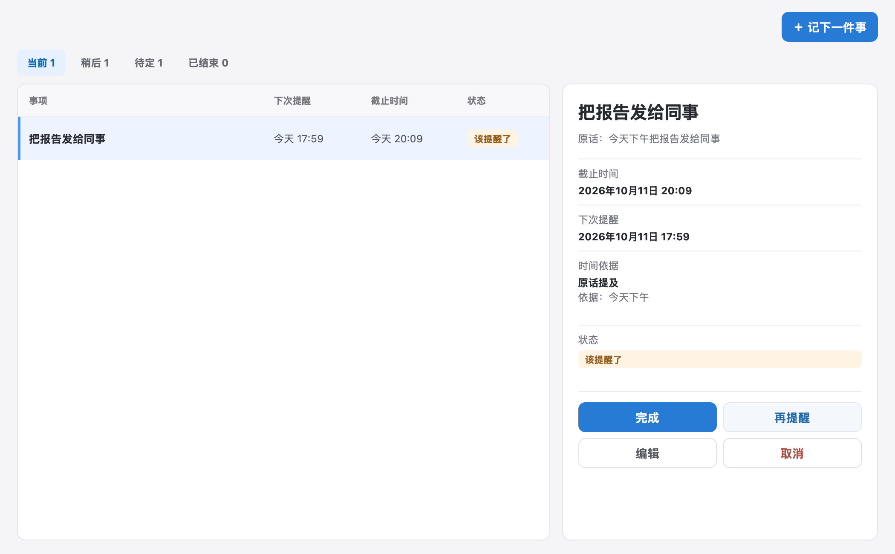
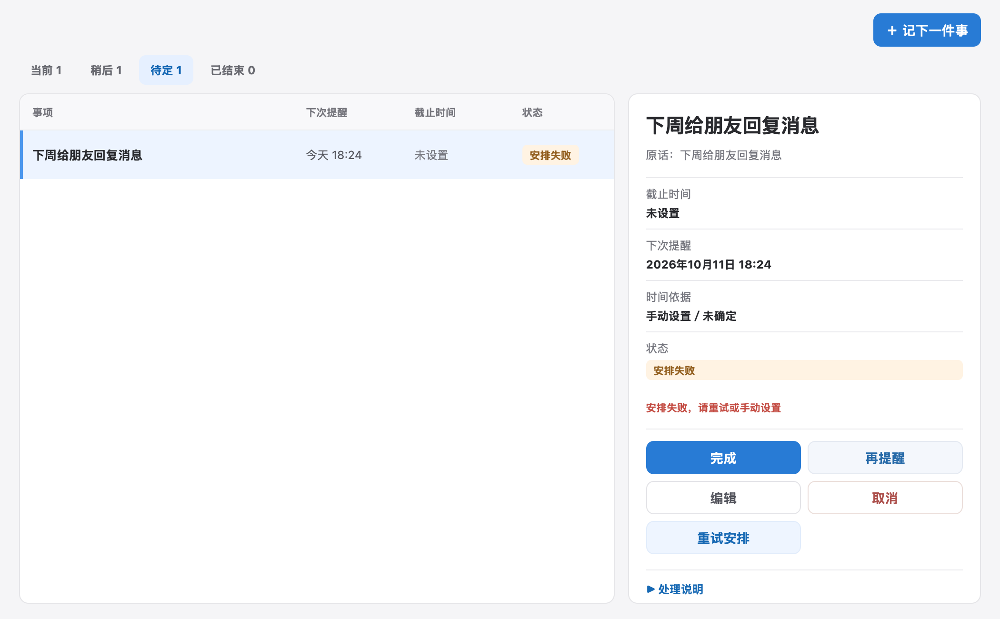
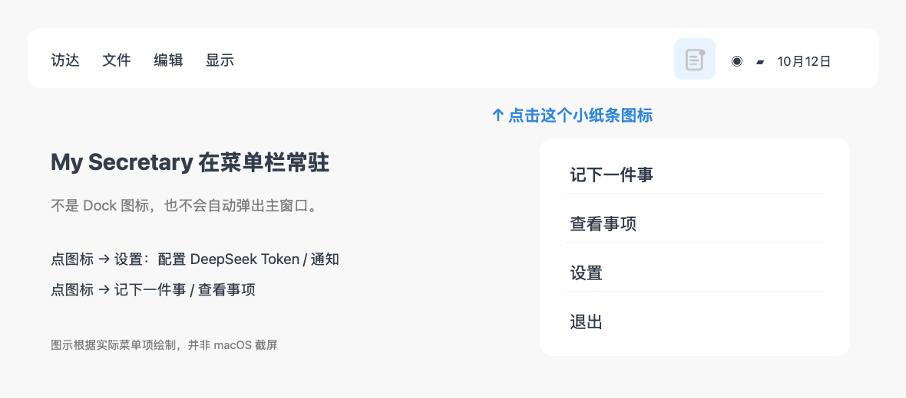

# My Secretary · 我的秘书

**答应了别人一件小事，转头就忙忘了？** My Secretary 是一款运行在 Mac 菜单栏的个人提醒助手：按快捷键，写下原话，它会尝试理解时间并安排提醒。你不必先打开待办软件、起标题、选日期、填表单。

> 例如，临时收到一句「明天 10 点前把报告发给同事」：按 `⌃⇧9` 输入原话、回车保存；应用会保留原话，尝试区分**提醒时间**和**明确截止时间**，并在到期时通过 macOS 通知提醒你。识别结果请自行核对。

## 应用界面

以下图片直接取自运行中的 macOS App，使用的是**虚构演示事项**，不是个人数据。界面会随版本和系统外观变化。

| 查看已到期事项、截止时间与操作 | 识别失败时保留原话，提供手动处理与重试 |
| --- | --- |
|  |  |

## 为什么做这个项目

工作中常有零碎请求：「等会儿帮我看一下」「明天记得发给我」。当下答应了，过后却被别的事情打断。传统待办工具适合整理任务，但对这种**先快速记下来、稍后有人提醒**的场景，录入步骤常常太多。

My Secretary 把重点放在三件事上：

| 你遇到的问题 | 它目前的做法 |
| --- | --- |
| 不想打断手头工作填待办表单 | 用菜单栏或全局快捷键打开小浮层，输入原话后回车保存；快捷键可自定义 |
| 一句话提到多个时间，怕提醒设错 | 使用 DeepSeek 尝试理解时间，并区分原话中的**明确截止**和参考性的**建议完成时间**；原话始终保留，方便核对 |
| 网络或模型出错，怕录入内容丢失 | 先保存在本机；识别失败会标为**待识别**，可手动设置时间或重试，而不是假装已经安排成功 |

已提供到期通知、事项列表、完成/取消、推迟提醒和每日汇总。**应用退出、通知被系统关闭或勿扰时，不保证按时弹出或被用户看到；AI 也可能理解错误。** 一句话包含多件独立行动时，它会提示分开录入，**不会自动拆成多个提醒**。

## 下载与安装

1. 前往 [GitHub Releases](https://github.com/wasai9715/my-secretary/releases)，下载最新的 **UNNOTARIZED 预览版** DMG：Apple Silicon（M 系列芯片）选 `arm64`，Intel Mac 选 `x86_64`。要求 **macOS 14 或更新版本**。
2. 打开 DMG，先阅读其中的 `READ-ME-FIRST.txt`，再将 `MySecretary.app` 拖入「应用程序」。从「应用程序」启动后，在**菜单栏**寻找入口；这是菜单栏应用，不会常驻 Dock。
3. 如果 macOS 拦截首次启动：**仅在确认下载自本仓库且你愿意承担风险时**，尝试打开一次，再到「系统设置 → 隐私与安全性」为 MySecretary 选择「仍要打开」。不要全局关闭 Gatekeeper，也不要运行批量移除隔离属性的命令。

⚠️ **这些 DMG 未经 Apple Developer ID 签名或 Apple 公证。** 可以下载同名 `.sha256` 文件核对传输完整性，但哈希**不能证明发布者身份**。如果不愿意手动放行未公证的软件，请暂时不要安装，等待未来的签名版本。

### 安装后只看到右上角的小图标？

**这就是应用的入口，属于正常情况。** My Secretary 常驻在屏幕顶部的 **macOS 菜单栏右侧**，不会在 Dock 里常驻图标，也不会在启动时自动打开主窗口。图中小纸条图标取自[实际 App 的菜单栏图标局部截图](docs/screenshots/menu-bar-icon.png)；菜单栏位置和菜单项是**示意图，不是系统截图**：



1. **点击顶部菜单栏右侧的小纸条图标**，展开菜单。第一次使用先点「设置」，填入自己的 DeepSeek API Token 并测试连接，再确认系统通知已开启；**未录入事项或未到提醒时间时，不会凭空弹出提醒**。
2. 点击「记下一件事」开始录入，或点「查看事项」打开[实际的事项管理界面](docs/screenshots/management-current.png)。设置完成后也可使用默认快捷键 `⌃⇧9`。
3. 如果没看到图标：先确认从「应用程序」启动了 MySecretary；菜单栏空间不足、刘海屏或菜单栏管理工具可能把右侧图标折叠或隐藏，试着退出占用菜单栏空间的应用、切换到 Finder 或检查菜单栏管理工具设置。仍找不到时，在「活动监视器」搜索 `MySecretary` 确认它是否运行，再尝试重启 App。**通知权限未开启时，菜单栏图标可能会变成带斜线的铃铛。**

## 三步开始使用

1. **配置模型和通知：**打开菜单栏中的「设置」，填入**你自己的 DeepSeek API Token**，点击测试连接；同时在 macOS「系统设置 → 通知」允许 MySecretary 发送通知。模型调用可能产生费用。通知权限关闭时，事项仍可查看，但到期提醒不可用。
2. **记下一件事：**按默认快捷键 `⌃⇧9`（Control + Shift + 9），或点击菜单栏「记下一件事」。输入一句原话，如「周五下午提醒我给同事回邮件」，按回车保存。可在设置中录制其他快捷键；快捷键冲突时会保留旧组合。
3. **核对并处理：**确认识别出的提醒时间，必要时手动修改；到期后通过通知或菜单栏列表打开事项，选择完成、取消或推迟。没有时间线索的事项目前默认在录入 **15 分钟后**提醒；识别失败的事项须手动处理或重试。

**隐私与数据：**事项和配置保存在本机 `~/Library/Application Support/MySecretary/`。模型请求会把当前输入及必要时间信息发往你配置的 HTTPS 模型服务，而不是上传全部历史。Token 目前保存在本地 `model.json`（仅当前用户权限），**尚未使用 macOS 钥匙串**；没有账号、跨设备同步、云备份或自动更新。不要在 Issue 中上传个人事项或 Token。更新时退出应用，下载新版覆盖 `.app`，本地数据不会随覆盖删除；卸载后若需清除数据，请自行删除上述目录。

## 开发者

本项目采用 Swift / SwiftUI 构建 macOS 菜单栏应用，使用 SQLite 保存事项，DeepSeek 辅助理解时间。**源码构建**需要安装 macOS Command Line Tools：

```bash
swift build
swift run SecretaryCoreChecks
swift run SecretaryPresetChecks
swift run SecretaryCommandChecks
scripts/build-app.sh
open dist/MySecretary.app
```

`build-app.sh` 生成的是 ad-hoc 临时签名 App；GitHub 的 DMG 也只是明确标注 UNNOTARIZED 的预览版，**不是 Apple 公证的软件**。更多自动检查和打包说明见 [发布指南](docs/releasing.md)；功能现状与待验证场景见 [真机验收清单](docs/design/mac-v1-acceptance-checklist.md)。

产品背景和设计：[产品与交互基线](docs/design/personal-reminder-v1.md) · [领域术语](CONTEXT.md) · [当前 OpenSpec 变更](openspec/changes/bootstrap-personal-reminder/) · [提示词评估记录](docs/design/reminder-prompt-evaluation-v10-v11.md)。这些文档包含尚未验收的计划，**不代表所有设计都已实现**。

## 许可证

[MIT](LICENSE)。
